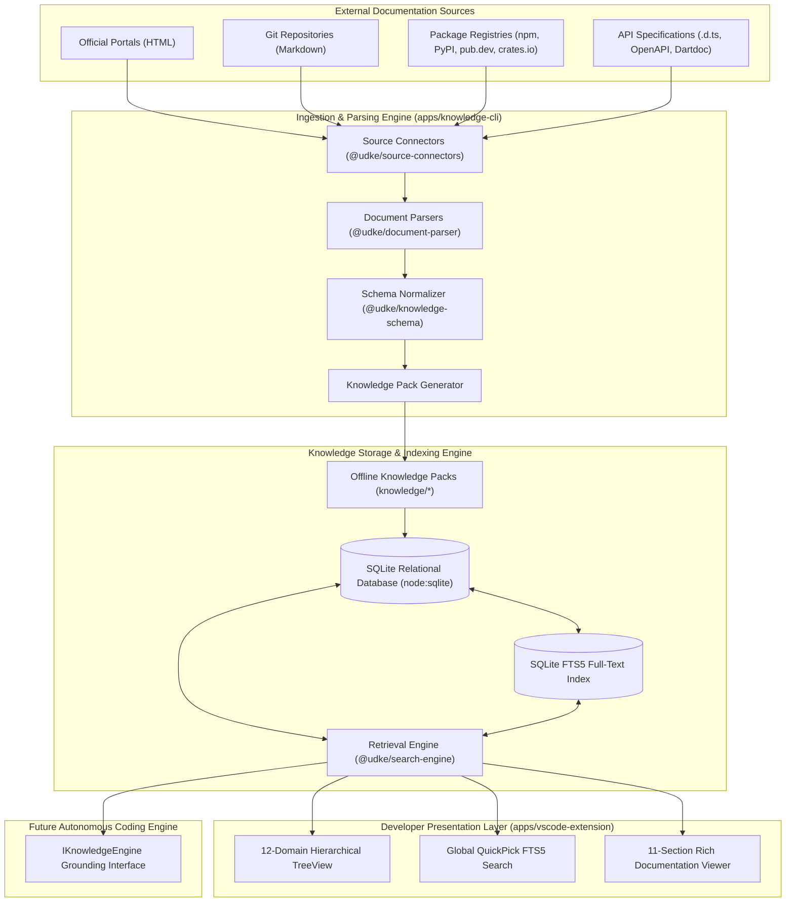

# System Architecture & Technical Specifications
## Universal Dev Knowledge Engine (UDKE) — Version 2.0
### The Universal Developer Knowledge Platform

> **Document Version**: 2.0  
> **Status**: Approved Specification  
> **Scope**: Complete Universal Programming Documentation Library  

---

## 1. Architectural Principles & System Design

Universal Dev Knowledge Engine (UDKE) is architected as an **offline-first, modular, TypeScript-based monorepo** with a decoupled knowledge core and an IDE presentation layer.



---

## 2. Universal Library Taxonomy (12 Master Domains)

The system organizes all technical knowledge into 12 authoritative domains:

| # | Master Domain | Scope & Technologies |
| :-: | :--- | :--- |
| **1** | **Programming Languages** | JavaScript, TypeScript, Python, Java, C, C++, C#, Dart, Go, Rust, PHP, Kotlin, Swift, Ruby |
| **2** | **Frontend Development** | HTML5, CSS3, React, Next.js, Vue, Angular, Svelte, Tailwind CSS |
| **3** | **Backend Development** | Node.js, Express, NestJS, Django, FastAPI, Spring Boot, Laravel, ASP.NET Core |
| **4** | **Mobile Development** | Flutter, Android Native, Kotlin Multiplatform, Swift/iOS, React Native, Jetpack Compose |
| **5** | **Databases & Storage** | PostgreSQL, MySQL, SQLite, MongoDB, Redis, Firebase Firestore, Supabase |
| **6** | **Authentication & Security** | OAuth 2.0, OpenID Connect, JWT, Argon2, bcrypt, WebAuthn, Passkeys, TLS/mTLS, WebCrypto |
| **7** | **APIs & Communication** | REST, GraphQL, WebSocket, gRPC, Webhooks, MQTT, OpenAPI, Server-Sent Events |
| **8** | **DevOps & Infrastructure** | Docker, Kubernetes, Git, GitHub Actions, Linux Systems, Nginx, CI/CD, Terraform |
| **9** | **Architecture & Design** | MVC, MVVM, Clean Architecture, Microservices, Event-Driven Architecture, Domain-Driven Design (DDD) |
| **10** | **Testing & Debugging** | Unit Testing, Integration Testing, E2E Testing, Playwright, Jest, Vitest, Profiling |
| **11** | **AI & Machine Learning** | PyTorch, TensorFlow, Hugging Face Transformers, LLMs, RAG Architectures, Embeddings, Vector Databases |
| **12** | **Tools & Environments** | VS Code, Antigravity, IntelliJ IDEA, Android Studio, Terminals, Package Managers |

---

## 3. Technology Hierarchy (14-Section Model)

Every technology in the system adheres to a standard 14-section navigational tree:
1. **Fundamentals**: Core concepts, execution models, and architecture.
2. **Installation & Setup**: Toolchain installation, version management, and configuration.
3. **Runtime & Architecture**: Process lifecycle, event loop, memory model, and threading.
4. **Core Modules**: Built-in packages and primitive libraries.
5. **File System**: Local storage, I/O operations, streams, and file descriptors.
6. **HTTP & Networking**: Sockets, clients, servers, and network protocols.
7. **Authentication**: Credentials, password hashing, tokens, and identity providers.
8. **Databases**: Native drivers, ORMs, query builders, and connection pools.
9. **API Development**: Endpoint routing, request validation, middleware, and serialization.
10. **Error Handling**: Exception hierarchies, recovery workflows, and logging.
11. **Security**: Hardening, vulnerability prevention, sanitization, and cryptography.
12. **Testing**: Test runners, assertion libraries, mocking, and coverage.
13. **Deployment**: Containerization, process managers, and release pipelines.
14. **API Reference**: Exhaustive formal symbol index (classes, functions, methods, parameters).

---

## 4. Library Entry Structure (11-Section Standard)

Every individual library, module, or package documentation page renders with these 11 sections:
1. **Overview**: Purpose, operational characteristics, and high-level use cases.
2. **Installation**: Specific package manager commands and peer dependencies.
3. **Syntax**: Formal signatures, types, and constructor declarations.
4. **Classes & Functions**: Complete breakdown of constructors, methods, parameters, and return types.
5. **Configuration**: Initialization options, defaults, and tuning parameters.
6. **Examples**: Tested, syntax-highlighted code snippets attributed to official documentation.
7. **Implementation**: Multi-step implementation pipelines detailing ordered procedures.
8. **Errors**: Common exceptions, root cause explanations, and mitigations.
9. **Security**: Cryptographic safety, input validation, and attack mitigations.
10. **Compatibility**: Supported runtime versions, OS platforms, and deprecation notices.
11. **References**: Upstream repository URL, SPDX license identifier, and verification metadata.

---

## 5. Modular Knowledge Pack Storage Strategy

To ensure scalable distribution without bloating memory or storage:
* Documentation is partitioned into independent **Knowledge Packs** under `knowledge/`.
* Each pack contains a `pack.json` manifest:
  ```json
  {
    "id": "pack.backend.nodejs",
    "name": "Node.js Complete Reference Pack",
    "domain": "backend",
    "technology": "Node.js",
    "version": "20.x",
    "license": "MIT",
    "recordCount": 24,
    "sizeBytes": 145000,
    "lastVerified": "2026-11-19"
  }
  ```
* Packs can be bundled locally or downloaded on-demand.
* The search engine registers installed packs in the `knowledge_packs` database table and maintains FTS5 indexes across all active packs.

---

## 6. Monorepo Package Boundaries & Invariants

```
universal-dev-knowledge-engine/
├── apps/
│   ├── vscode-extension/          # IDE Presentation Layer (TreeView, QuickPick, Webview)
│   └── knowledge-cli/             # Automated Ingestion & Pack Generator CLI
├── packages/
│   ├── knowledge-schema/          # Canonical Zod schemas & TypeScript types (Pure)
│   ├── search-engine/             # SQLite + FTS5 search engine (Decoupled Core)
│   ├── document-parser/           # Cheerio HTML & Remark Markdown parsers
│   └── source-connectors/         # Ecosystem connectors (npm, pub.dev, Git, web)
├── database/
│   └── schema.sql                 # Authoritative SQLite DDL & FTS5 triggers
├── knowledge/                     # Independent offline knowledge packs
│   ├── packs.json                 # Global pack registry
│   ├── languages/
│   ├── frontend/
│   ├── backend/
│   ├── mobile/
│   ├── databases/
│   ├── authentication/
│   ├── security/
│   ├── apis/
│   ├── devops/
│   ├── architecture/
│   ├── testing/
│   ├── ai-ml/
│   └── tools/
└── tests/                         # Full-stack integration test suites
```

### Strict Architectural Boundaries:
* `packages/*` **never** import from `apps/*`.
* `apps/vscode-extension` and `apps/knowledge-cli` consume `packages/*` as modular libraries.
* Search engine operates through pure SQLite + FTS5 with zero external network calls.
* All data crossing ingestion boundaries must validate against `@udke/knowledge-schema` Zod schemas.

---

## 7. Future AI Grounding Substrate

The knowledge core exposes a stable programmatic interface for future AI models:

```typescript
export interface IKnowledgeEngine {
  search(query: string, options?: SearchOptions): Promise<SearchResult[]>;
  getDocument(id: string): Promise<DocumentationRecord | null>;
  getSymbol(name: string, context?: { language?: string; version?: string }): Promise<SymbolRecord | null>;
  getPipeline(id: string): Promise<ImplementationPipeline | null>;
  getRelated(id: string): Promise<DocumentationRecord[]>;
  getSource(sourceId: string): Promise<SourceMetadata | null>;
}
```

Future AI agents will invoke these methods to obtain deterministic, verified syntax and workflows, eliminating hallucinated code generation.
